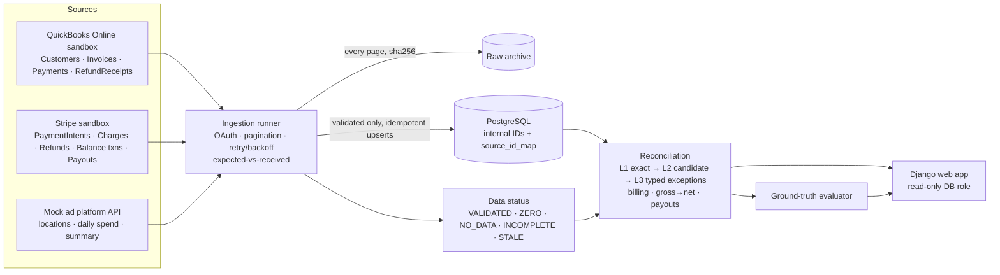
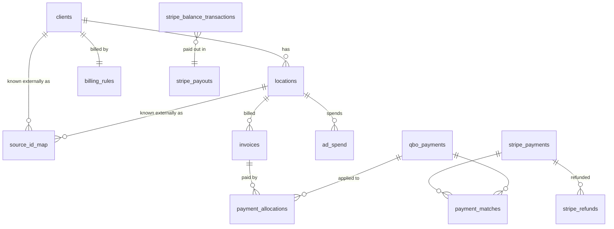

# Multi-Location Finance Reconciliation Pipeline

[](https://github.com/jjeong4335/finrecon/actions/workflows/ci.yml)

> **Independent portfolio demonstration.** This demonstration uses synthetic sandbox financial records and historical
> public retail transaction data from UCI. No real QuickBooks or Stripe customer transactions are included. Not
> affiliated with any company named in this project, Intuit, or Stripe.

A small, correct data system that pulls accounting records (QuickBooks Online), payment-processing records (Stripe)
and advertising spend (a mock ad platform) for **3 clients × 15 locations**, maps every external ID to stable internal
IDs, validates completeness, reconciles the systems against each other, and explains every exception in a dashboard.
A separate module loads **1.07 million real public retail transactions** (UCI Online Retail II) to show the same
discipline on messy real-world data.

**Live demo:** [3-229-13-33.sslip.io](https://3-229-13-33.sslip.io) (AWS EC2, served from the QuickBooks + Stripe sandbox snapshot) · **Start here:** [exceptions](https://3-229-13-33.sslip.io/reconciliation/) · **Static snapshot:** `python -m finrecon.pipeline report`

```bash
git clone https://github.com/jjeong4335/finrecon && cd finrecon
pip install -r requirements-dev.txt
python -m finrecon.pipeline demo && python manage.py runserver     # http://127.0.0.1:8000
```

It was built to answer, with working code, six questions from a Finance Data Analyst interview:

| Interview question | Where it is answered |
|---|---|
| How would you pull reports through APIs for many clients and locations? | `finrecon/ingestion/runner.py`, `finrecon/adapters/` |
| How do you know the data is complete and accurate? | expected-vs-received, pagination, source totals, duplicates, data status |
| How would you relate client, location, invoice, transaction and payment IDs? | `db/schema.sql` (`source_id_map`, `payment_allocations`) |
| How do you find transactions in one system but missing from another? | `finrecon/recon/sql/*.sql`, `finrecon/recon/engine.py` |
| Explain your pipeline architecture. | this README, dashboard page 4 |
| How would you connect QuickBooks, Stripe and the internal platform? | spend → invoice → payment → payout |

## 30-second tour (for a reviewer)

1. **Overview**: scenario validation badge (computed from the evaluator's table), KPIs, top exceptions.
2. **Reconciliation** → filter `MISSING_IN_QBO` → select the row: reason, Stripe ID, the invoice it claims to pay,
   archived raw API pages. Then `NEEDS_REVIEW`: two identical $500 deposits and one QBO entry. The engine refuses to guess.
3. **Data Quality**: Paterson's ad API is down → `NO_DATA`, never $0. Astoria's latest pull failed → `STALE`,
   last validated data kept.
4. **Billing & Payouts**: one invoice charged the fee twice; one month of spend was never invoiced; every payout =
   gross − fees − refunds.
5. **Retail Data Quality**: 1.07M real rows, nothing dropped; cancellations, bad-debt adjustments, missing customer
   IDs, repeated lines and sheet overlap, each counted and explained.

## Why reconciliation matters

Stripe says money arrived; QuickBooks says what the books believe. When a sync drops, duplicates or mis-keys a payment,
AR is wrong, revenue is wrong and month-end close stalls. The expensive mistakes are the quiet ones: an API outage
that shows up as "$0 spend", a refund that never reached the ledger, a hand-entered payment that matches the wrong
charge. This project treats each of those as a first-class, explainable state.

## Architecture



**Stack:** Python 3.12, PostgreSQL 16 (SQLite for the offline test suite), FastAPI (mock API), Django (read-only web app, served by gunicorn), pytest,
Docker Compose, Caddy (automatic HTTPS), AWS EC2. No ORM: SQL is explicit and lives in `db/` and `finrecon/recon/sql/`.

## Data model



Six accounting entities are kept distinct: **invoice** (amount billed), **Stripe payment** (processing record),
**QBO payment** (accounting record of cash received), **allocation** (`Line.LinkedTxn`: which invoice a payment paid),
**balance transaction** (gross, fee, net) and **payout** (cash to the bank). QBO and Stripe payments are two records of
the same money: they are matched, never added together.

- Internal UUIDs derive from business keys; `(source, external_id)` is unique on every table, so loads are idempotent.
- Locations map to QBO **sub-customers** and to Stripe `metadata.location_key`. `DepartmentRef` is not used as a key.
- Money is `BIGINT` cents plus currency. QBO decimals are parsed with `Decimal` and converted in one tested function.

## Reconciliation method

| Level | Rule |
|---|---|
| 1 · exact | The payment sync writes the Stripe PaymentIntent id into the QBO payment memo. If several QBO records cite the same id, the one whose amount agrees with Stripe is the match (else the earliest); the rest are `DUPLICATE`. |
| 2 · candidate | No id in the memo, card method: same client, currency, amount, dates within ±3 days. Accepted only if the pair is **mutually unique**, else `NEEDS_REVIEW`. |
| 3 · typed exceptions | Everything left gets a status and a plain-English reason. |

| Status | Meaning | Exception? |
|---|---|---|
| MATCHED | Both records agree (invoices: fully paid) | no |
| PARTIAL | Allocations cover part of an invoice | no |
| OPEN_AR | Unpaid invoice (aging shown) | no |
| PENDING_SYNC | In Stripe, not yet in QBO, inside the 2-day sync window | no |
| NON_STRIPE_PAYMENT | Check/ACH: no Stripe record expected | no |
| MISSING_IN_QBO | Stripe collected cash QBO never recorded | yes |
| MISSING_IN_STRIPE | QBO records a card payment Stripe does not have | yes |
| AMOUNT_MISMATCH | Matched records whose amounts differ | yes |
| DUPLICATE | One Stripe payment recorded twice in QBO | yes |
| UNRECORDED_REFUND | Stripe refund not reflected in QBO | yes |
| NEEDS_REVIEW | Ambiguous; a person must decide | yes |

Data status is a separate dimension per source × location: `VALIDATED`, `ZERO_TRANSACTIONS` (a complete answer of
zero), `NO_DATA`, `INCOMPLETE`, `STALE`. A failed or partial pull is recorded and retried with bounded backoff, is never
loaded over the last validated data, and is never shown as $0.

Billing is reconciled separately: *expected invoice = spend + max(fee %, minimum) − discount + tax* per location-month
(synthetic rules in `billing_rules`). Then gross − fee = net for every balance transaction, and each payout equals the
net of the transactions attached to it. Journal-entry previews (Stripe Clearing account) are educational only.

All time rules use `RECON_AS_OF` (2026-11-30), never the clock, so the deployed demo never changes its answers.

## Synthetic data and ground truth

`seed/scenarios.py` is one deterministic plan (fixed random seed) describing 4 months of activity: 4,284 ad-spend rows,
55 invoices, 46 Stripe payments, 47 QBO payments, refunds and payouts, plus **27 named scenarios**:

| Code | Scenario | Code | Scenario |
|---|---|---|---|
| S00 | Baseline paid + synced | S13 | Fee billed twice |
| S01 | Partial payment | S14 | Paid yesterday: pending sync |
| S02 | Two payments settle one invoice | S15 | Spend never invoiced |
| S03 | One payment, two invoices | S16 | Invoices not yet due (open AR) |
| S04 | QBO recorded $45 less | D01 | New location: genuine zero |
| S05 | Never synced to QBO | D02 | Ad API always 503 → NO_DATA |
| S06 | Paid by check | D03 | Latest pull failed → STALE |
| S07 | Duplicate import | D04 | Silently missing page → INCOMPLETE |
| S08 | Refund not in QBO | D05 | Detail ≠ source summary → INCOMPLETE |
| S09 | Refund recorded | D06 | HTTP 429, retried |
| S10 | Hand-entered, unique candidate | D07 | Duplicate rows across pages |
| S11 | Two identical deposits → review | | |
| S12 | QBO cites a Stripe ID that does not exist | S17 | Wrong amount imported first, correct one second |
| | | S18 | Unique same-amount candidate, conflicting location |
| | | S19 | Unique same-amount candidate, conflicting invoice reference |

The plan renders three ways: API-shaped offline fixtures, real sandbox objects (`seed/live_seed.py`), and
`tests/fixtures/expected_reconciliation.json`. Expected statuses come from **scenario intent**, not from running the
engine, and are keyed by a `seed_key` carried in Stripe metadata and the QBO memo (API-generated IDs differ per run).
The evaluator writes correct / wrong / missed / unexpected per item; tests prove it fails when the engine is wrong.

The offline demo runs ingestion twice (as of Nov 25 and Nov 30) to show incremental loads, a failure that leaves
stale data, and partial extracts that are rejected.

## Real public data: UCI Online Retail II

| Source | Role | Real or synthetic |
|---|---|---|
| QuickBooks Online sandbox | Invoices, recorded payments, allocations | synthetic |
| Stripe sandbox | Payment processing, refunds, fees | synthetic |
| Mock ad API | Spend per client and location, ingestion failures | synthetic |
| **UCI Online Retail II** | Cleaning and validating real transaction data at scale | **real public data** |

Chen, D. (2012). *Online Retail II* [Dataset]. UCI Machine Learning Repository. https://doi.org/10.24432/C5CG6D
(CC BY 4.0). About 1.07M invoice lines from a UK online retailer, 2009-12 to 2011-12, in GBP. The file is downloaded
at run time, not stored in this repository.

```bash
python -m finrecon.ingestion.uci_retail all      # download (~44 MB) and load; a few minutes
```

| Real-data problem | How it is handled |
|---|---|
| Missing customer ID | Kept in revenue, excluded from customer-level analysis, counted |
| Cancellation invoices (`C…`) | Separate class; each traced to an earlier sale of the same item to the same customer where possible |
| Bad-debt adjustments (`A…`) | Separate class, never mixed with sales |
| Postage, fees, manual lines | NON_PRODUCT class by stock-code pattern |
| Negative quantity on a sale | STOCK_ADJUSTMENT (write-offs, damages) |
| Repeated identical lines | Flagged, **not deleted**: the same item can legitimately be keyed twice |
| Invoice repeated across sheets | Identical copy excluded once; differing copies kept and flagged |
| Zero prices, sub-penny amounts, missing descriptions | Flagged and counted |
| 1M+ rows | Chunked loads (50k rows per transaction) with timings per stage |

Control checks prove nothing is lost: raw rows = parsed rows, and line totals = sum of classes = invoice totals.

### Results on the real file

Full load on a MacBook: **1,067,371 rows in 73 s** (read + parse 40 s, write 26 s, validate 7 s).

| Check | Rows | Share | What it means |
|---|---:|---:|---|
| Rows read = rows kept | 1,067,371 | 100% | Nothing dropped; matches the row count UCI publishes |
| Sheet overlap excluded | 22,523 | 2.1% of all rows | Invoices present identically in both sheets. Summing the sheets naively would count them twice |
| Sheet overlap conflicts | 0 | | No invoice differs between the two sheets, so excluding the copy is safe |
| Canonical lines | 1,044,848 | | Basis for every figure below |
| Control totals | | | Lines = sum of classes = invoices = £18,909,762.10 (net of cancellations and adjustments) |
| Missing customer ID | 235,287 | 22.5% | Kept in revenue, excluded from customer-level analysis |
| Repeated identical lines | 22,813 | 2.2% | Flagged, not deleted: the data cannot tell a duplicate from two units keyed separately |
| Cancellation lines | 19,165 | 1.8% | 15,913 (83%) traced to an earlier sale; 2,533 (13%) have none in the data; 719 (4%) have no customer ID |
| Zero unit price | 6,024 | 0.6% | Flagged |
| Non-product lines | 4,794 | 0.5% | Postage, fees, manual lines |
| Missing description | 4,275 | 0.4% | Flagged |
| Stock adjustments | 3,362 | 0.3% | Negative quantity on a sale invoice |
| Sub-penny amounts | 18 | | Rounded half-up to the penny |
| Bad-debt adjustments | 6 | | `A…` invoices, kept apart from sales |
| Invalid rows | 0 | | Every row parsed |
The retail data has no Stripe or QuickBooks IDs, so it is never matched against the reconciliation, and `Country`
is the customer's country, not a store location.

## Test results

```
$ python -m pytest
88 tests. All run in CI on SQLite and again on PostgreSQL 16 (one FastAPI route test is skipped where FastAPI is
not installed)

$ python -m finrecon.pipeline demo
Scenario validation: 27 / 27 scenarios passed, 226 / 226 items correct,
0 false-positive exceptions, 0 missed exceptions
```

Required checks covered: idempotent re-runs · Stripe-only (pending vs missing) · QBO-only by payment method · amount
mismatch · open AR not an exception · partial and multi-invoice allocations, no double counting · failure → NO_DATA,
never zero · ground truth with zero misses and zero false positives · gross − fee = net and payout totals ·
traceability to source ID, run and raw bytes (sha256) · ambiguous candidates → review · location and pagination
coverage, 429 retried · cents ↔ decimal conversion · every web page rendered through Django's test client (all record types, filters, 404s) ·
UCI module: classification, duplicate vs. overlap handling, cancellation tracing, control totals, idempotent reload,
both header variants (tested on hand-written rows in the UCI layout, `tests/fixtures/uci_format/`).

**Scale:** the real 1,067,371-row file loads in 73 s on a MacBook (SQLite).

**Continuous integration** (`.github/workflows/ci.yml`, on every push): the full suite and a strict demo run
(fails unless every scenario matches the ground truth) on SQLite and on a PostgreSQL 16 service through the psycopg
driver; and the Docker stack end to end: images build, the pipeline job runs on PostgreSQL in Docker, the dashboard
answers through Caddy, and the dashboard's database role is verified to be read-only.

**Live sandbox run.** The same scenarios were created in a QuickBooks Online sandbox company and a Stripe
sandbox through their APIs (OAuth 2.0 with rotating refresh tokens on the QBO side), ingested twice and reconciled:
**27 / 27 scenarios, 226 / 226 items correct**. 151 QBO records came back, 48 of them Intuit's sample company data;
those map to no registered client and are counted as out of scope rather than reconciled. The first live run
surfaced three integration issues that offline tests could not: Stripe no longer accepts `payment_method_types`
on PaymentIntents (now `automatic_payment_methods`), Stripe remembers an idempotency key even for a rejected request
(keys now include a hash of the parameters), and token-refresh errors now report Intuit's own reason. The sandbox
had no payouts yet, so payout checks ran only offline.

**Public demo data.** `fixtures/live_snapshot/` holds the real API responses captured from that sandbox run
(`python -m seed.live_seed capture`, with Stripe `client_secret` and receipt URLs removed). The deployed dashboard
serves it offline, so it shows real sandbox data without holding any tokens, and CI checks on every push that it
still reproduces 27 / 27.

**Matching edge cases.** S17–S19 were added after a code review asked how the engine handles a wrong first
record and coincidental same-amount candidates. Run against the new ground truth, the previous engine failed all
three (it matched the wrong record and auto-matched contradicting candidates); the engine was then fixed. A
candidate is now accepted only if it is mutually unique *and* nothing contradicts it.

**PostgreSQL compatibility:** the schema loads on PostgreSQL 16; all 124 application SELECTs were replayed on
PostgreSQL with 66 final-state queries compared value by value against SQLite (identical), and all 85 write
statements (DDL, `ON CONFLICT` upserts, deletes) executed successfully. The UCI load sequence was replayed on
PostgreSQL with identical resulting tables.

## What is verified and what is not

| Component | Status |
|---|---|
| Offline pipeline, reconciliation, evaluator, report | Run and tested |
| SQL on PostgreSQL 16 | Verified by replay, and the full suite runs on PostgreSQL through psycopg in CI |
| Django web app | Every page rendered in CI through Django's test client (SQLite and PostgreSQL) and through Caddy in the Docker job |
| Mock API over real HTTP | Tested with a stdlib server; FastAPI wrapper tested where FastAPI is installed |
| QBO / Stripe live adapters, `seed/live_seed.py` | **Run end to end against real QuickBooks Online and Stripe sandboxes:** seeded, ingested twice through the APIs, reconciled — 27 / 27 scenarios, 226 / 226 items correct |
| UCI module on the real file | Loaded end to end on a MacBook: 1,067,371 rows in 73 s, control totals passed (results below) |
| Docker Compose stack | Built and exercised end to end in CI (pipeline, dashboard via Caddy, read-only role) |
| EC2 / HTTPS deployment | Configuration and guide provided, not yet deployed |

## Local setup

```bash
# Python 3.10+ (CI uses 3.12)
python -m pip install -r requirements-dev.txt
python -m finrecon.pipeline demo        # builds data/finrecon.db (SQLite) and prints the evaluation
python -m pytest
python manage.py runserver              # http://127.0.0.1:8000
python -m finrecon.pipeline report      # reports/snapshot.html, a static fallback
```

Docker (PostgreSQL + dashboard + Caddy): `cp .env.example .env`, set passwords, `docker compose up -d --build`.
AWS deployment: [docs/DEPLOY_AWS.md](docs/DEPLOY_AWS.md). Live sandboxes: [docs/LIVE_SANDBOX.md](docs/LIVE_SANDBOX.md).

## Repository layout

```
finrecon/adapters/     QBO (OAuth2, STARTPOSITION paging), Stripe (cursor paging), mock ad API, offline transports
finrecon/ingestion/    runner (retry, checkpoints, data status), normalize, raw archive, uci_retail (real public data)
finrecon/recon/        engine.py, sql/*.sql, billing.py, accounting.py, evaluator.py
finrecon/              config, db (PostgreSQL/SQLite), money, ids, dashboard_data, report, pipeline CLI
mock_ad_api/           framework-free service + FastAPI app + stdlib server
seed/                  scenario plan, offline fixture generator, live sandbox seeder + snapshot capture
db/schema.sql          the data model (+ db/retail_staging.sql for the UCI module)
webapp/                Django app (read-only; 6 pages + record detail), templates in webapp/templates/
docs/                  deployment, live sandbox guide, design notes per module
```

## Limitations and next steps

- Reconciliation data is synthetic: the billing formula, card fees and the Stripe→QBO sync are simulated to create
  known cases. Only the UCI retail module uses real data, and it is kept separate.
- Sandbox objects cannot be back-dated; live seeding stores the business date in `metadata.event_date`.
- USD only; multi-currency needs an explicit FX policy first.
- QBO and Stripe are re-read in full each run (small volumes). Next: change-data-capture (QBO CDC, Stripe events).
- Next: payout ↔ bank-deposit matching in QBO, scheduled runs (EventBridge), S3 raw retention, Parameter Store secrets,
  Alembic migrations, a human review workflow for `NEEDS_REVIEW` items.
